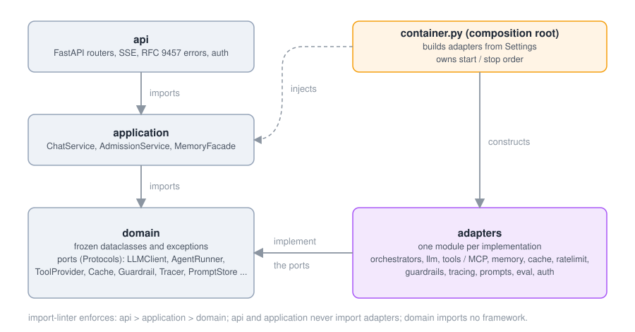
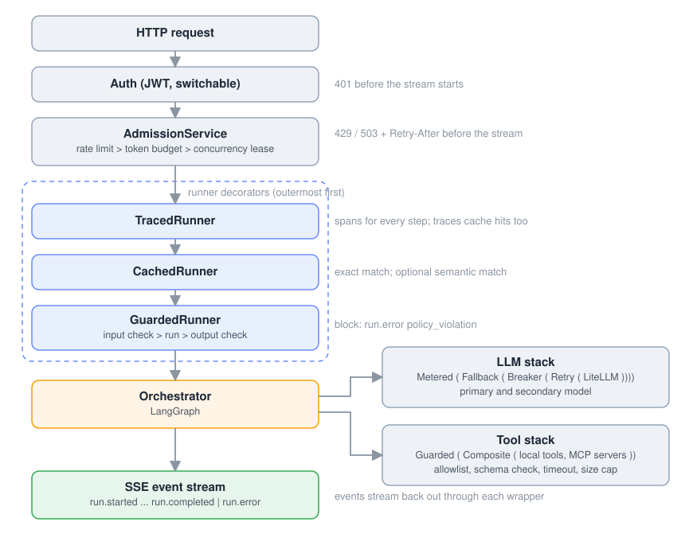

# Architecture

* **domain**: frozen dataclasses, exceptions and `Protocol` ports. No framework imports.
* **application**: use cases that depend only on ports.
* **adapters**: one module per implementation; heavy SDKs are imported lazily.
* **composition root**: `container.py` builds adapters from `Settings` and owns start/stop order.

`import-linter` enforces this (`make arch`): api > application > domain; api/application never import
adapters; domain never imports a framework.

## Port + Adapter + Registry

Each port has a `Registry[T]` in `adapters/registries.py` mapping a name to a lazy `"module:attr"`
factory. Choosing an implementation is config only (`AGENT_<COMPONENT>__PROVIDER`). A missing optional
SDK raises a `ConfigurationError` naming the uv extra. Third parties can register adapters through
entry points in the `agent_svc.<port>` group.

## Request path

The SSE events are `run.started`, `step.*`, `message.delta`, `usage`, `message.completed` and then `run.completed` or `run.error`.

* **TracedRunner** is outermost, so cache hits are traced too.
* **CachedRunner** sits outside the guard: cached answers were output-checked when stored.
* **GuardedRunner** checks the newest user message before the agent runs and the answer before it leaves
  (`buffer` mode never leaks a blocked answer; `stream` mode trades that for latency).
* Every framework is bridged to the **LLM port**, so retry, breaker, fallback and metering apply to all
  five orchestrators the same way (see ADR 0002).

## Streaming contract

`POST /v1/threads/{id}/chat` returns `text/event-stream`. Events carry a numeric `id`; a client resumes
with `Last-Event-ID`; an `Idempotency-Key` replays a finished run. A heartbeat comment is sent every
15 s. Failures after the stream starts arrive as `run.error` (an RFC 9457 problem body is used before
the stream starts).

## Extras

Heavy dependencies live in uv extras (`litellm`, `langgraph`,
`mcp`, `mlflow`, `mlflow_genai`, `presidio`, `guardrails_ai`).
They resolve together in one lock; CI also proves the orchestrator extra alone.
`llm-guard` has no extra: its pins conflict with the lock.
